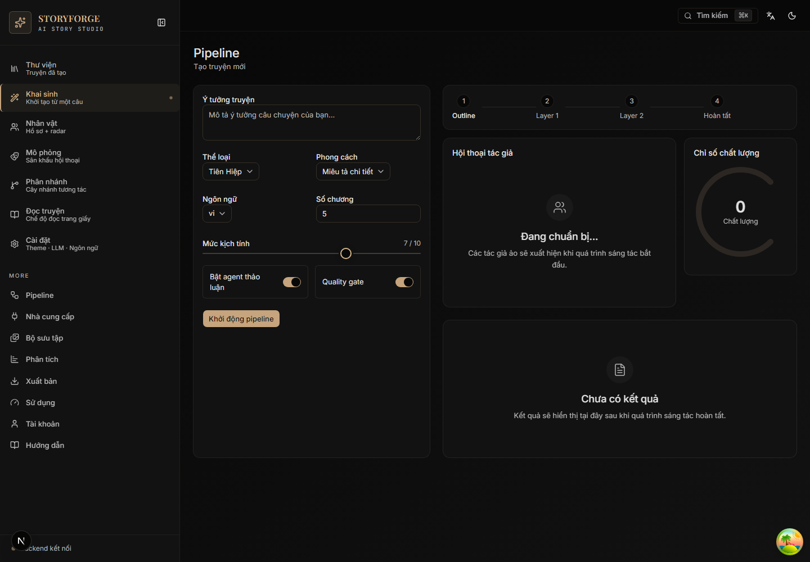
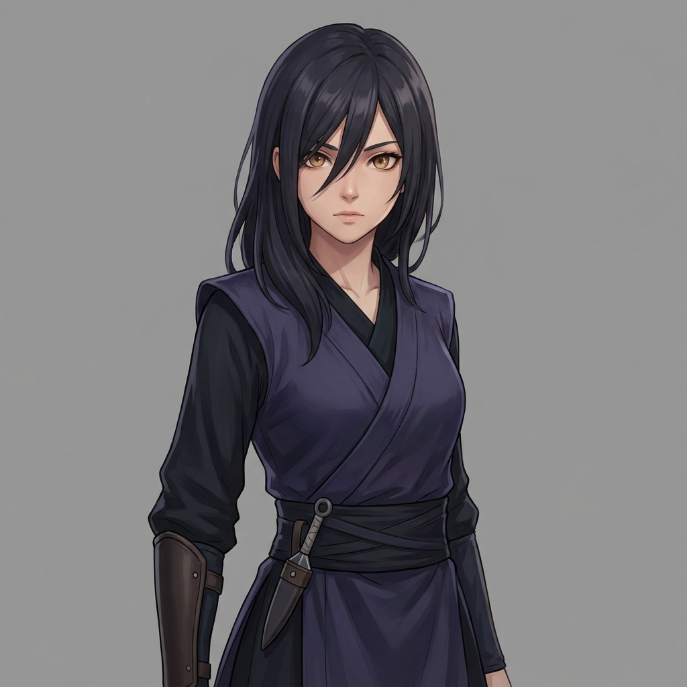

<h1 align="center">StoryForge</h1>

<p align="center"><strong>AI story generation with multi-agent drama simulation</strong></p>

<p align="center">
  <a href="https://www.python.org/"></a>
  <a href="https://fastapi.tiangolo.com"></a>
  <a href="LICENSE"></a>
  <a href="README.vi.md">Tiếng Việt</a>
</p>

<p align="center">
  
</p>

StoryForge turns a one-sentence idea into a complete web novel. Characters act as autonomous agents that argue, ally and betray each other in a multi-round drama simulation; the story is then rewritten around the conflicts they uncover. It runs on your own machine with Docker, uses any OpenAI-compatible LLM (cloud or local), and keeps all data in local volumes. Vietnamese-first, with other genres and languages supported.

## Sample output

Character-consistent portraits (same face across chapters) and a scene background, generated by the pipeline for a Vietnamese tiên hiệp story.

<table>
  <tr>
    <td align="center" width="33%"><br/><sub><b>Triệu Thiên Phong</b> · protagonist</sub></td>
    <td align="center" width="33%"><br/><sub><b>Tiểu Vũ</b> · heroine</sub></td>
    <td align="center" width="33%"><br/><sub><b>Hắc Phong Lão Tổ</b> · antagonist</sub></td>
  </tr>
</table>

<p align="center">
  
</p>

## Quick start

You need [Docker](https://docs.docker.com/get-docker/) with Compose, and an API key for an LLM provider (or a local model, see below).

```bash
git clone https://github.com/HieuNTg/STORYFORGE.git
cd STORYFORGE
docker compose up -d
```

Open **http://localhost:3001**, go to **Settings → API Keys**, add a provider and model, then use **Forge** to generate a story.

- The first build compiles from source and takes about 10 minutes (CPU-only PyTorch). Later starts are fast.
- Ports are bound to `127.0.0.1` only: web on `3001`, API on `7860`.
- Your data lives in two named Docker volumes: `storyforge-data` (`/app/data`: `config.json`, encrypted API keys, the auto-generated `.secret_key`, SQLite database, caches, logs) and `storyforge-output` (`/app/output`: generated files). `docker compose down` keeps them; `docker compose down -v` deletes them.
- Prebuilt images (`compose.release.yaml`, selected with `STORYFORGE_VERSION`) will be available once a release is published.

## Using a local model

Run [Ollama](https://ollama.com) on the host, pull a model, then in **Settings** pick the Ollama preset. From inside the container the host is reached at:

```
http://host.docker.internal:11434/v1
```

Any non-empty API key works for Ollama.

## Features

- **Two-layer pipeline**: L1 story generation, then L2 drama simulation, with checkpoints and streamed progress.
- **9 agents**: 8 `BaseAgent` subclasses (character specialist, continuity checker, dialogue balance, dialogue expert, drama critic, editor in chief, pacing analyzer, style consistency) plus the reader simulator. Output is reviewed and auto-revised against quality thresholds.
- **Vietnamese-first**: Vietnamese names and style by default; tiên hiệp / wuxia / xianxia and Western / sci-fi genres available.
- **Continuation tools**: continue a story, outline editing, consistency checks, mid-story insertion.
- **Branching reader**: LLM-generated choose-your-own-adventure sessions with a tree view and EPUB export of the tree.
- **Comics**: generate comic panels for library stories and chapters (needs an image provider).
- **Character portraits**: character-consistent images (see below).
- **Exports**: PDF, EPUB, DOCX, HTML, a ZIP bundle (TXT / Markdown / JSON / HTML).
- **Any OpenAI-compatible LLM**: OpenAI, Gemini, Anthropic, OpenRouter (which also reaches Z.AI and many others), Ollama or any custom OpenAI-compatible endpoint, with fallback and a response cache.

## Image providers

Images are off by default (text-only). Choose a provider in **Settings → General → Image provider** and enter its key in **Settings → API Keys**, or set the `STORYFORGE_IMAGE_PROVIDER` environment variable (see `.env.example`).

| Provider | Needs | Cost | Notes |
|----------|-------|------|-------|
| `none` | nothing | free | Default. No image calls. |
| `huggingface` | `hf_token` | free tier | FLUX.1-schnell via the HF Inference API. |
| `dalle` | `image_api_key` (+ optional `image_api_url`) | paid | OpenAI / Azure-compatible endpoint. |
| `sd-api` | a Stable Diffusion API endpoint | varies | Self-hosted or hosted SD API. |
| `seedream` | `seedream_api_key`, `seedream_api_url` | paid | ByteDance Seedream; default engine for character consistency. |
| `replicate` | `replicate_api_key` | paid | Character consistency only (`character_consistency_provider`); not used for plain image generation. |

Character consistency reuses a character's first portrait as a reference image: set `enable_character_consistency` and use `seedream` or `replicate` as `character_consistency_provider`.

Image engines that automated consumer web sessions (FlowKit, Gemini Web, Codex image, local Qwen) were removed because of account-ban risk.

## Configuration

Settings are stored in `data/config.json` (inside the `storyforge-data` volume) and edited from the Settings page. Environment variables are optional:

| Variable | Purpose |
|----------|---------|
| `STORYFORGE_ACCESS_TOKEN` | Optional shared token. When set, the UI shows an unlock screen. |
| `STORYFORGE_ALLOWED_HOSTS` | Extra accepted Host names, comma-separated (names only, no ports or wildcards). |
| `STORYFORGE_ALLOWED_ORIGINS` | Extra browser origins (e.g. `http://192.168.1.20:3001`), comma-separated, added to the `localhost` defaults. Their host names are trusted too. |
| `STORYFORGE_SECRET_KEY` | Optional Fernet key for encrypting stored keys. If unset, one is generated in `data/.secret_key`. |
| `STORYFORGE_DEBUG` | Enables the API docs at `/docs`. |
| `STORYFORGE_DB_PATH` | SQLite database path. |
| `STORYFORGE_HOST` / `STORYFORGE_PORT` | Bind address and port when running from source (defaults `127.0.0.1` / `7860`). |

`compose.yaml` also sets `STORYFORGE_IN_CONTAINER` for you; you do not need to touch it.

## Cost

StoryForge is free software, but **you pay your LLM (and image) provider** for every call, and a long story makes many calls. Set a budget with the per-run caps (`0`, the default, disables a cap):

| Environment variable | Config field | Meaning |
|----------|---------|---------|
| `STORYFORGE_MAX_COST_PER_RUN_USD` | `llm.max_cost_per_run_usd` | Stop a run once its estimated cost reaches this many US dollars. |
| `STORYFORGE_MAX_TOKENS_PER_RUN` | `llm.max_total_tokens_per_run` | Stop a run after this many tokens. |
| `STORYFORGE_MAX_CALLS_PER_RUN` | `llm.max_calls_per_run` | Stop a run after this many LLM calls. |

The Settings page does not expose them yet. With Docker, set them on the `api` service in a `compose.override.yaml` next to `compose.yaml`, then run `docker compose up -d`:

```yaml
services:
  api:
    environment:
      STORYFORGE_MAX_COST_PER_RUN_USD: "2"
      STORYFORGE_MAX_TOKENS_PER_RUN: "2000000"
      STORYFORGE_MAX_CALLS_PER_RUN: "300"
```

Running from source, put them in `.env` (see `.env.example`) or edit `data/config.json`. An environment variable wins over `config.json`. The **Usage** page shows token usage.

## Privacy and security

- Everything stays on your machine. The only outbound traffic is to the LLM and image providers you configure.
- By default the stack listens on localhost only and has no login.
- To reach it from another device on your LAN, change the port bindings **and** set `STORYFORGE_ACCESS_TOKEN` (and `STORYFORGE_ALLOWED_ORIGINS` for the address you browse to). See [docs/self-hosting.md](docs/self-hosting.md). Do not expose it to the internet.
- API keys are encrypted at rest. See [SECURITY.md](SECURITY.md) to report a vulnerability.

## UI routes

| Route | What it does |
|-------|--------------|
| `/forge` | Create a story from one sentence and watch the pipeline run. |
| `/library` | Your saved stories; the starting point for most other tools. |
| `/reader` | Read a story chapter by chapter, with bookmarks. |
| `/branching` | Start and play branching (choose-your-own-adventure) sessions. |
| `/simulation` | Set up a multi-character drama simulation for a story. |
| `/characters` | Browse, edit and generate characters and portraits. |
| `/continue` | Continue a finished story with more chapters. |
| `/export` | Export a story to PDF, EPUB, DOCX, HTML or ZIP. |
| `/analytics` | Per-story quality, word counts, chapters, events and character graph. |
| `/gallery` | Stories shared publicly from this instance. |
| `/providers` | Status of the configured LLM provider profiles. |
| `/settings` | LLM providers, models, image provider and pipeline settings. |
| `/usage` | Token and cost usage. |
| `/account` | Local summary: stories created and tokens used. |
| `/guide` | In-app user guide. |

## Development

Python 3.11+ and Node 24.

```bash
python -m venv .venv && source .venv/bin/activate   # Windows Git Bash: source .venv/Scripts/activate
pip install -r requirements.txt -r requirements-test.txt
# Linux: append --extra-index-url https://download.pytorch.org/whl/cpu to get the
# CPU-only torch wheel instead of the multi-GB CUDA build.
(cd frontend && npm ci)

python scripts/dev.py        # starts the API and the Next.js dev server
```

`requirements.lock.txt` pins the exact versions for the Docker image and CI. It is compiled for Linux x86_64 and Python 3.12, so it does not install on Windows or macOS; use `requirements.txt` there.

Tests:

```bash
python -m pytest -q -m "not calibration and not bench and not perf"

cd frontend && npm ci && npx vitest run
```

See [CONTRIBUTING.md](CONTRIBUTING.md) and [ARCHITECTURE.md](ARCHITECTURE.md). Licensed under [MIT](LICENSE).
