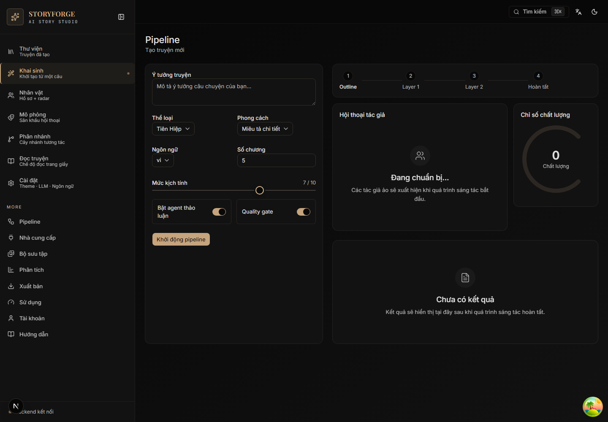
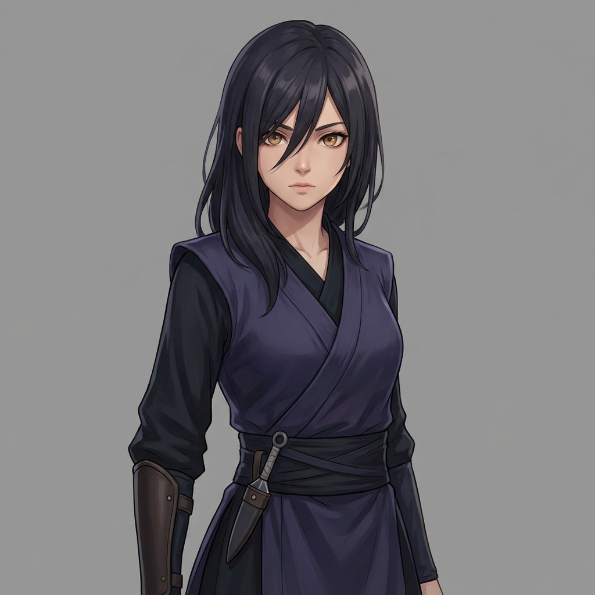

<h1 align="center">StoryForge</h1>

<p align="center"><strong>Tạo truyện bằng AI với mô phỏng kịch tính đa tác tử</strong></p>

<p align="center">
  <a href="https://www.python.org/"></a>
  <a href="https://fastapi.tiangolo.com"></a>
  <a href="LICENSE"></a>
  <a href="README.md">English</a>
</p>

<p align="center">
  
</p>

StoryForge biến một câu ý tưởng thành một bộ web novel hoàn chỉnh. Mỗi nhân vật là một tác tử tự chủ: tranh luận, kết minh, phản bội nhau qua nhiều vòng mô phỏng kịch tính, rồi truyện được viết lại quanh những xung đột đó. Chạy ngay trên máy của bạn bằng Docker, dùng được mọi LLM tương thích OpenAI (đám mây hoặc local), dữ liệu nằm trong volume cục bộ. Ưu tiên tiếng Việt, hỗ trợ thêm các thể loại và ngôn ngữ khác.

## Ảnh mẫu

Chân dung nhân vật nhất quán (cùng một gương mặt qua các chương) và nền cảnh do pipeline tạo cho một truyện tiên hiệp.

<table>
  <tr>
    <td align="center" width="33%"><br/><sub><b>Triệu Thiên Phong</b> · nam chính</sub></td>
    <td align="center" width="33%"><br/><sub><b>Tiểu Vũ</b> · nữ chính</sub></td>
    <td align="center" width="33%"><br/><sub><b>Hắc Phong Lão Tổ</b> · phản diện</sub></td>
  </tr>
</table>

<p align="center">
  
</p>

## Bắt đầu nhanh

Bạn cần [Docker](https://docs.docker.com/get-docker/) có Compose, và API key của một nhà cung cấp LLM (hoặc model local, xem bên dưới).

```bash
git clone https://github.com/HieuNTg/STORYFORGE.git
cd STORYFORGE
docker compose up -d
```

Mở **http://localhost:3001**, vào **Settings → API Keys**, thêm nhà cung cấp và model, rồi dùng **Forge** để tạo truyện.

- Lần build đầu biên dịch từ mã nguồn, mất khoảng 10 phút (PyTorch bản CPU). Các lần khởi động sau nhanh hơn nhiều.
- Cổng chỉ bind vào `127.0.0.1`: web ở `3001`, API ở `7860`.
- Dữ liệu nằm trong hai volume Docker: `storyforge-data` (`/app/data`: `config.json`, API key đã mã hóa, `.secret_key` tự sinh, cơ sở dữ liệu SQLite, cache, log) và `storyforge-output` (`/app/output`: file được tạo ra). `docker compose down` giữ lại dữ liệu; `docker compose down -v` sẽ xóa.
- Image dựng sẵn (`compose.release.yaml`, chọn bản bằng `STORYFORGE_VERSION`) sẽ có khi bản phát hành đầu tiên được công bố.

## Dùng model local

Chạy [Ollama](https://ollama.com) trên máy chủ, tải một model, rồi chọn preset Ollama trong **Settings**. Từ trong container, máy chủ được gọi qua:

```
http://host.docker.internal:11434/v1
```

Ollama chấp nhận bất kỳ API key không rỗng nào.

## Tính năng

- **Pipeline hai tầng**: L1 tạo truyện, sau đó L2 mô phỏng kịch tính, có checkpoint và truyền tiến trình theo thời gian thực.
- **9 tác tử**: 8 lớp con của `BaseAgent` (character specialist, continuity checker, dialogue balance, dialogue expert, drama critic, editor in chief, pacing analyzer, style consistency) cộng reader simulator. Kết quả được đánh giá và tự chỉnh sửa theo ngưỡng chất lượng.
- **Ưu tiên tiếng Việt**: mặc định tên và văn phong Việt; có thêm thể loại tiên hiệp / võ hiệp / huyền huyễn và phương Tây / khoa học viễn tưởng.
- **Công cụ viết tiếp**: viết tiếp truyện, chỉnh dàn ý, kiểm tra nhất quán, chèn giữa truyện.
- **Trình đọc rẽ nhánh**: truyện tương tác do LLM sinh ra, có cây rẽ nhánh và xuất EPUB của cây.
- **Truyện tranh**: tạo các khung truyện tranh cho truyện/chương trong thư viện (cần provider ảnh).
- **Chân dung nhân vật**: ảnh nhân vật nhất quán (xem bên dưới).
- **Xuất file**: PDF, EPUB, DOCX, HTML, gói ZIP (TXT / Markdown / JSON / HTML).
- **Mọi LLM tương thích OpenAI**: OpenAI, Gemini, Anthropic, OpenRouter (qua đó dùng được Z.AI và nhiều nhà cung cấp khác), Ollama hoặc bất kỳ endpoint tùy chỉnh tương thích OpenAI, có dự phòng và cache phản hồi.

## Provider ảnh

Mặc định tắt ảnh (chỉ văn bản). Chọn provider trong **Settings → Chung → Image provider** và nhập key của nó trong **Settings → Khóa API**, hoặc đặt biến môi trường `STORYFORGE_IMAGE_PROVIDER` (xem `.env.example`).

| Provider | Cần | Chi phí | Ghi chú |
|----------|-----|---------|---------|
| `none` | không | miễn phí | Mặc định. Không gọi tạo ảnh. |
| `huggingface` | `hf_token` | gói miễn phí | FLUX.1-schnell qua HF Inference API. |
| `dalle` | `image_api_key` (+ tùy chọn `image_api_url`) | trả phí | Endpoint tương thích OpenAI / Azure. |
| `sd-api` | endpoint Stable Diffusion API | tùy | SD API tự host hoặc dịch vụ ngoài. |
| `seedream` | `seedream_api_key`, `seedream_api_url` | trả phí | ByteDance Seedream; engine mặc định cho nhất quán nhân vật. |
| `replicate` | `replicate_api_key` | trả phí | Chỉ dùng cho nhất quán nhân vật (`character_consistency_provider`); không dùng để tạo ảnh thông thường. |

Nhất quán nhân vật dùng chân dung đầu tiên của nhân vật làm ảnh tham chiếu: bật `enable_character_consistency` và đặt `character_consistency_provider` là `seedream` hoặc `replicate`.

Các engine ảnh tự động hóa phiên web tiêu dùng (FlowKit, Gemini Web, Codex image, Qwen local) đã bị gỡ vì nguy cơ khóa tài khoản.

## Cấu hình

Cài đặt được lưu trong `data/config.json` (trong volume `storyforge-data`) và chỉnh ở trang Settings. Biến môi trường là tùy chọn:

| Biến | Mục đích |
|------|----------|
| `STORYFORGE_ACCESS_TOKEN` | Token dùng chung, tùy chọn. Khi đặt, giao diện hiện màn hình mở khóa. |
| `STORYFORGE_ALLOWED_HOSTS` | Tên Host được chấp nhận thêm, phân tách bằng dấu phẩy (chỉ tên, không có cổng hay ký tự đại diện). |
| `STORYFORGE_ALLOWED_ORIGINS` | Origin trình duyệt bổ sung (ví dụ `http://192.168.1.20:3001`), phân tách bằng dấu phẩy, cộng thêm vào các origin `localhost` mặc định. Tên host của chúng cũng được tin cậy. |
| `STORYFORGE_SECRET_KEY` | Khóa Fernet tùy chọn để mã hóa key đã lưu. Nếu không đặt, khóa tự sinh trong `data/.secret_key`. |
| `STORYFORGE_DEBUG` | Bật tài liệu API tại `/docs`. |
| `STORYFORGE_DB_PATH` | Đường dẫn cơ sở dữ liệu SQLite. |
| `STORYFORGE_HOST` / `STORYFORGE_PORT` | Địa chỉ và cổng khi chạy từ mã nguồn (mặc định `127.0.0.1` / `7860`). |

`compose.yaml` cũng tự đặt `STORYFORGE_IN_CONTAINER`; bạn không cần chỉnh biến này.

## Chi phí

StoryForge là phần mềm miễn phí, nhưng **bạn trả tiền cho nhà cung cấp LLM (và ảnh)** cho mỗi lệnh gọi, và một truyện dài tạo ra rất nhiều lệnh gọi. Đặt ngân sách bằng các giới hạn theo mỗi lần chạy (`0`, mặc định, là tắt giới hạn):

| Biến môi trường | Trường cấu hình | Ý nghĩa |
|----------|---------|---------|
| `STORYFORGE_MAX_COST_PER_RUN_USD` | `llm.max_cost_per_run_usd` | Dừng lần chạy khi chi phí ước tính đạt số đô la Mỹ này. |
| `STORYFORGE_MAX_TOKENS_PER_RUN` | `llm.max_total_tokens_per_run` | Dừng lần chạy sau ngần này token. |
| `STORYFORGE_MAX_CALLS_PER_RUN` | `llm.max_calls_per_run` | Dừng lần chạy sau ngần này lệnh gọi LLM. |

Trang Settings chưa hiển thị các giá trị này. Với Docker, đặt chúng cho service `api` trong file `compose.override.yaml` cạnh `compose.yaml`, rồi chạy `docker compose up -d`:

```yaml
services:
  api:
    environment:
      STORYFORGE_MAX_COST_PER_RUN_USD: "2"
      STORYFORGE_MAX_TOKENS_PER_RUN: "2000000"
      STORYFORGE_MAX_CALLS_PER_RUN: "300"
```

Khi chạy từ mã nguồn, đặt chúng trong `.env` (xem `.env.example`) hoặc sửa `data/config.json`. Biến môi trường thắng giá trị trong `config.json`. Trang **Usage** cho biết lượng token đã dùng.

## Quyền riêng tư và bảo mật

- Mọi thứ nằm trên máy bạn. Lưu lượng ra ngoài chỉ gồm các nhà cung cấp LLM và ảnh mà bạn cấu hình.
- Mặc định hệ thống chỉ lắng nghe trên localhost và không có đăng nhập.
- Muốn truy cập từ thiết bị khác trong mạng LAN, hãy đổi cổng bind **và** đặt `STORYFORGE_ACCESS_TOKEN` (cùng `STORYFORGE_ALLOWED_ORIGINS` cho địa chỉ bạn mở trong trình duyệt). Xem [docs/self-hosting.md](docs/self-hosting.md). Không mở ra internet.
- API key được mã hóa khi lưu. Báo lỗ hổng bảo mật theo [SECURITY.md](SECURITY.md).

## Các route giao diện

| Route | Chức năng |
|-------|-----------|
| `/forge` | Tạo truyện từ một câu và theo dõi pipeline chạy. |
| `/library` | Các truyện đã lưu; điểm xuất phát của hầu hết công cụ khác. |
| `/reader` | Đọc truyện theo từng chương, có đánh dấu. |
| `/branching` | Bắt đầu và chơi các phiên truyện rẽ nhánh. |
| `/simulation` | Thiết lập mô phỏng kịch tính nhiều nhân vật cho một truyện. |
| `/characters` | Xem, sửa và tạo nhân vật, chân dung. |
| `/continue` | Viết tiếp một truyện đã hoàn thành. |
| `/export` | Xuất truyện ra PDF, EPUB, DOCX, HTML hoặc ZIP. |
| `/analytics` | Chất lượng, số từ, chương, sự kiện và đồ thị nhân vật của từng truyện. |
| `/gallery` | Truyện được chia sẻ công khai từ instance này. |
| `/providers` | Trạng thái các hồ sơ nhà cung cấp LLM đã cấu hình. |
| `/settings` | Nhà cung cấp LLM, model, provider ảnh và cài đặt pipeline. |
| `/usage` | Mức dùng token và chi phí. |
| `/account` | Tóm tắt cục bộ: số truyện đã tạo và token đã dùng. |
| `/guide` | Hướng dẫn sử dụng trong ứng dụng. |

## Phát triển

Python 3.11+ và Node 24.

```bash
python -m venv .venv && source .venv/bin/activate   # Windows Git Bash: source .venv/Scripts/activate
pip install -r requirements.lock.txt --extra-index-url https://download.pytorch.org/whl/cpu
(cd frontend && npm ci)

python scripts/dev.py        # chạy API và dev server Next.js
```

Chạy test:

```bash
pip install -r requirements.lock.txt -r requirements-test.txt --extra-index-url https://download.pytorch.org/whl/cpu
python -m pytest -q -m "not calibration and not bench and not perf"

cd frontend && npm ci && npx vitest run
```

Xem [CONTRIBUTING.md](CONTRIBUTING.md) và [ARCHITECTURE.md](ARCHITECTURE.md). Giấy phép [MIT](LICENSE).
